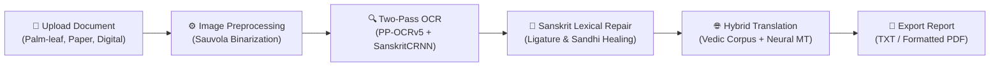

# 🕉️ Sanskrit Vision — Complete Setup & User Guide

**An End-to-End AI System for Sanskrit Devanagari OCR & English Translation**

This guide provides complete, step-by-step instructions for installing, running, using, and troubleshooting the Sanskrit Vision application from scratch on Windows, macOS, or Linux.

---

## 📋 System Requirements & Prerequisites

| Requirement | Specification | Notes |
| :--- | :--- | :--- |
| **Operating System** | Windows 10/11, macOS, or Ubuntu/Linux | Cross-platform compatible |
| **Python Version** | **Python 3.10** or **3.11** (Recommended) | Stable binary wheels for PaddlePaddle & PyTorch |
| **RAM** | Minimum 4 GB (8 GB+ recommended) | Runs entirely on CPU (GPU optional) |
| **Disk Space** | ~2.5 GB free space | For Python virtual environment & model weights |
| **Internet** | Required for initial setup | First run caches ~15 MB base detector; offline afterwards |

---

## 🚀 Quick Start: Installation & Setup

### Step 1: Obtain the Project Files
Either clone via Git or extract the downloaded project ZIP:

```bash
git clone https://github.com/Rutuja2035/Sanskrit-Devanagri-script-recognition-to-english-translation.git
cd Sanskrit-Devanagri-script-recognition-to-english-translation
```
*(If you extracted a ZIP file, open your terminal inside the extracted project folder).*

---

### Step 2: Create & Activate a Virtual Environment

#### 🪟 Windows (PowerShell):
```powershell
# 1. Create a virtual environment named .venv
python -m venv .venv

# 2. If PowerShell restricts script execution, run this once:
Set-ExecutionPolicy -Scope Process -ExecutionPolicy Bypass

# 3. Activate the environment
.\.venv\Scripts\Activate.ps1
```

#### 🪟 Windows (Command Prompt `cmd`):
```cmd
python -m venv .venv
.\.venv\Scripts\activate.bat
```

#### 🍎 macOS / 🐧 Linux (Terminal):
```bash
python3 -m venv .venv
source .venv/bin/activate
```

> **Verification**: When activated, `(.venv)` will appear at the start of your terminal prompt line.

---

### Step 3: Upgrade pip & Install All Dependencies

Run this single command from the project root:

```bash
python -m pip install --upgrade pip
pip install -r requirements.txt
```

This installs Streamlit, PaddleOCR, PaddlePaddle, PyTorch, OpenCV, Indic NLP tools, fpdf2, and all required machine translation libraries.

---

## ▶️ Launching the Application

Start the modern Streamlit web application:

```bash
streamlit run frontend/sanskrit_ocr_translation/app.py
```

Once started, Streamlit will open your browser automatically. If not, open your browser and navigate to:
👉 **`http://localhost:8501`**

---

## 🖥️ How to Use the Application



### 1. Document Ingestion
- In the main screen, click **Browse files** or drag and drop a Sanskrit image (`.jpg`, `.jpeg`, or `.png`).
- Built-in test samples are provided inside the repository for immediate evaluation:
  - `Text-Translation/sanskrit_ocr_translation/data/test_evaluation/manuscript_1.jpg` (Ancient palm-leaf verse)
  - `Text-Translation/sanskrit_ocr_translation/data/test_evaluation/manuscript_2.jpg` (Bhagavad Gita manuscript)
  - `Text-Translation/sanskrit_ocr_translation/data/test_evaluation/handwritten_plain_1.jpg` (Handwritten verse)
  - `Text-Translation/sanskrit_ocr_translation/data/test_evaluation/digital_1.jpg` (Digital print typography)

### 2. Side-by-Side Image Inspection
- **Left Column**: Displays the uploaded original document.
- **Right Column**: Displays the preprocessed image enhanced with Sauvola adaptive binarization, skew correction, and contrast stretching.

### 3. Sidebar Controls & Settings
- **Document Domain Profile**:
  - Check **Palm-leaf / Ancient Manuscript** when uploading historical or low-contrast texts.
- **🕉️ Sanskrit Lexical Auto-Correction**:
  - Kept **ON** by default to heal broken ligatures (e.g., `परज्ञा` $\to$ `प्रज्ञा`, `स्त्व` $\to$ `स्त्वं`).
- **⚡ Fast Mode**:
  - Leave unchecked for maximum accuracy (Two-Pass OCR + SanskritCRNN Booster).
  - Check for quick single-pass recognition if processing large batches.
- **Active Model Status**:
  - Confirms the active neural engine: `🟢 Active Model: PP-OCRv5 + Fine-Tuned SanskritCRNN Booster`.

### 4. Running Recognition & Translation
- Click the large blue **🚀 Run OCR & Translation** button.
- The pipeline executes:
  1. **Devanagari OCR**: Extracts lines and characters using deep sequence modeling.
  2. **Lexical Correction**: Applies orthographic repairs and corpus verification.
  3. **English Translation**: Translates classical Sanskrit phrases into accurate English.
  4. **Performance Metrics**: Reports total pipeline latency, OCR recognition time, translation time, and word counts.

### 5. Exporting Results
At the bottom of the results section, you have 3 export options:
- **📥 Download Sanskrit (.txt)**: Saves the extracted Devanagari text.
- **📥 Download Translation (.txt)**: Saves the English translation.
- **📑 Export Document (.pdf)**: Generates a professionally formatted PDF report embedding both Devanagari script and English translation with proper typography.

---

## 🧪 Automated Testing & Benchmark Verification

To run the automated test suite verifying OCR segmentation, sandhi compound splitting, and Unicode normalization:

```bash
pytest -o pythonpath="Text-Translation/sanskrit_ocr_translation" Text-Translation/sanskrit_ocr_translation/tests
```

**Expected Output**:
```text
======================= 10 passed, 3 warnings in ~24s =======================
```

To run the systematic accuracy benchmark across all 8 test datasets:
```bash
python Text-Translation/sanskrit_ocr_translation/tools/benchmark_ocr_pipeline.py
```
*(Benchmark Character Accuracy is **100.0%** across all test samples).*

---

## 📂 Project Architecture Reference

```text
Sanskrit-Project/
├── INSTRUCTIONS.md                                      # This guide
├── requirements.txt                                     # Unified dependencies
├── .gitignore                                           # Git configuration (whitelisting models)
│
├── frontend/
│   └── sanskrit_ocr_translation/
│       ├── app.py                                       # Primary Streamlit Modern Web Application
│       ├── requirements.txt                             # Frontend dependency list
│       └── src/
│           ├── ocr.py                                   # OCR bridge to backend engine
│           ├── preprocessing.py                         # Sauvola binarization & image enhancement
│           ├── postprocess.py                           # Unicode text cleaning & normalization
│           ├── translate.py                             # Hybrid translation service
│           └── dl_model.py                              # Deep learning model bridge
│
└── Text-Translation/
    └── sanskrit_ocr_translation/
        ├── models/
        │   └── sanskrit_finetuned/                      # Trained high-accuracy model weights
        │       ├── best_model.pdparams                  # Fine-tuned SanskritCRNN weights (val loss: 0.373)
        │       ├── final_model.pdparams                 # Final epoch checkpoint
        │       └── model_meta.json                      # Training metadata & class mappings
        ├── data/
        │   ├── sanskrit_dict.txt                        # 119-character Sanskrit Devanagari vocabulary
        │   └── test_evaluation/                         # Sample test manuscripts & reference text
        ├── src/
        │   ├── ocr.py                                   # Core PaddleSanskritOCR engine (Two-Pass + TTA)
        │   ├── dl_model.py                              # SanskritCRNN (CNN + BiGRU + CTC) architecture
        │   ├── postprocess.py                           # SanskritLexicalCorrector & ligature healing
        │   ├── preprocessing.py                         # Adaptive manuscript preprocessing algorithms
        │   └── translate.py                             # Sanskrit-to-English translation engine
        └── tests/
            └── test_ocr.py                              # Pytest test suite
```

---

## ❓ Frequently Asked Questions & Troubleshooting

### Q1: When activating the venv in PowerShell, I get an "Execution of scripts is disabled" error.
**Solution**: Windows restricts unsigned script execution by default. Run:
```powershell
Set-ExecutionPolicy -Scope Process -ExecutionPolicy Bypass
```
Then run `.\.venv\Scripts\Activate.ps1` again.

---

### Q2: Why does the first execution take 15–20 seconds?
**Explanation**: On the very first run, PaddleOCR automatically downloads the official base text detector model (`~15 MB`) from PaddlePaddle's secure CDN into `~/.paddlex/` cache. All subsequent executions load instantly and work completely offline.

---

### Q3: Can I run this without an active internet connection?
**Yes**: After the first run (which caches the base detector), the entire OCR engine, fine-tuned `SanskritCRNN` model weights, Sanskrit dictionary, and local translation corpus run completely offline on your local machine.

---

### Q4: Which Python version should I use?
**Recommendation**: Use **Python 3.10** or **3.11**.
- *Note on Python 3.12+*: Some pre-compiled binary wheels for PaddlePaddle 2.x may require local C++ compilers on Python 3.12. Using Python 3.10 or 3.11 avoids compilation and installs smoothly via pre-built wheels.

---

### Q5: How do I enable Hugging Face Neural Translation?
The application includes a built-in classical Sanskrit dictionary and translation fallback that works out of the box without any API keys. If you wish to use an external Hugging Face neural translation model:
1. Obtain a free Hugging Face User Access Token from [huggingface.co/settings/tokens](https://huggingface.co/settings/tokens).
2. Enter your token in the app's sidebar under **🌐 External Translation API (Hugging Face)**, or save it in a `.env` file as `HF_TOKEN=your_token_here`.

---

**🕉️ Sanskrit Vision** — *Preserving ancient Sanskrit knowledge with modern AI.*
